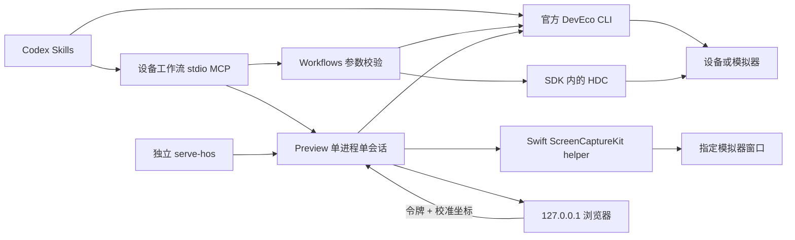

# 架构与验收标准

范围：macOS 本地 HarmonyOS 开发插件、独立浏览器设备预览、Codex stdio MCP。工程创建/构建/部署/UI 操作复用官方 DevEco CLI；单独安装 HAP、启动已安装应用和系统键复用官方 HDC。只新增官方工具目前没有提供的浏览器层与设备工作流 MCP。

## 现成能力与新增代码

| 模块 | 职责 / 边界 |
| --- | --- |
| `src/adapter.mjs` | 子进程参数数组、超时和输出上限；CLI JSON；设备/项目/PNG 校验；HDC 定位 |
| `src/tools.mjs` | MCP 工具共享业务入口；显式项目与设备；图片输出；输入参数校验 |
| `src/mcp.mjs` | 官方 MCP SDK stdio 协议；工具发现、错误响应；进程结束时停止预览 |
| `src/preview.mjs` | 浏览器 HTTP、帧缓存、SCK/HDC 状态切换、校准、坐标映射、会话清理 |
| `native/HOSCapture.swift` | 指定窗口捕获、JPEG 编码、原子文件、完整帧与窗口状态分别输出 |
| `web/` | 当前画面、拖选校准、点击/拖动、文本、系统返回、UI 树和画面保存 |
| `skills/` | 两项补充工作流和两项原样官方 Skill |

ScreenCaptureKit 已是系统框架，适合当前 Mac 的可见窗口捕获。`serve-sim` 耦合 simctl/iOS framebuffer，HOScrcpy 的平台/设备端二进制和许可证边界增加集成成本；本版使用系统框架与现有 HDC，见研究记录的逐项来源。

## 帧、坐标和状态

1. 启动先取得 HDC PNG 与真实设备分辨率。核实 serial 是运行中的本机模拟器，并以窗口 PID 的实际启动参数匹配模拟器名称。单可见窗口可自动选择，多个窗口由使用者显式选择 ID；身份无法确认时 HDC 降级。
2. Swift 捕获一个窗口，不捕获桌面或音频。完整帧编码 JPEG，原子替换 `latest.jpg`；JSON 消息仅记录元数据。Node 保存最新完整图片，HTTP 返回缓存，浏览器每 100 ms 拉取；静态图复用现有位图。
3. 窗口点、SCK 图像像素、设备像素是三个坐标空间。使用者拖选归一化触摸屏矩形：设备点 = `(浏览器归一化点 - 屏幕矩形原点) / 屏幕矩形大小 × (设备尺寸 - 1)`。矩形外输入拒绝，浮点边缘误差被限制到合法最后一个像素。
4. SCK 原始 contentRect 只表示窗口内容，不代表设备触摸屏。捕获固定初始像素尺寸；当前窗口 bounds 和周期 HDC 分辨率变化降级为设备截图，避免用旧窗口帧重新校准。contentRect/scale 或图像尺寸变化清除校准。重新启用 SCK 需停止/启动后重新拖选。
5. 每秒窗口状态消息独立于新图。健康静止窗口可沿用最后帧；最小化/完全离屏/关闭、状态超时、捕获退出或首帧缺失触发 HDC。输入后 2.5 秒仍没有新的 SCK 图也降级；无视觉变化的无效点按可能保守触发这一降级。
6. HDC 使用 `devecocli ui screenshot`，其内部是 `snapshot_display` + `file recv`。轮询串行，采用独立临时目录，清理每张源图；过期或来源切换后尚未取得对应帧时禁止输入。SCK 时每 5 秒检查 HDC 分辨率，发现旋转/折叠后的尺寸变化后降级。
   同时比较设备 PNG 指纹和窗口帧进度；设备画面已变化而窗口帧没有变化时降级，覆盖由其他 MCP 工具或设备端操作造成的后台重绘停滞。
7. 降级保持 HDC，不自动反复尝试 SCK；恢复窗口后重启会话明确重新选择窗口。

## 访问与生命周期

服务只监听 `127.0.0.1`。HTTP Host 和 Origin 必须匹配本机端口；设备数据/API 要求每会话随机 Bearer 令牌。令牌在 URL fragment，由页面读取，不发送给外部域。页面没有外部资源、跨域脚本或 CORS；包含 CSP、no-referrer 和 nosniff。

浏览器仅调用固定动作，MCP 仅执行固定命令；没有任意 shell 命令入口。构建项目必须存在，截图不覆盖已有文件，CLI 使用参数数组执行。bundle/ability 等进入设备 shell 的值按标识符验证。

文本的 CLI 1.3.0 封装在本机出现空格截断。共享适配层以官方 CLI 的节点点击建立焦点，随后把 `uitest uiInput text` 与 POSIX 单引号转义后的文字整段编码为 Base64，仅传输固定 `printf %s BASE64 | base64 -d | sh`。host tokenizer 只看编码串，设备 sh 解码后仅解析一次被引用的字面文字；包含引号、换行和 shell 字符的纯参数检查覆盖这一信任边界。此焦点命令要求 API 18+，本机 API 26 已实际验证。

预览的端口、临时目录和捕获子进程归创建它的进程所有。start/stop 串行执行，避免并发覆盖资源。MCP stop 清理自己的 helper/HTTP；stdin EOF 和终止信号额外取消本进程的开发命令及进程组，随后等待截图并清理目录。停止浏览器页面不会终止预览；这允许 Codex 与网页同时控制同一会话。共享 DevEco/Hvigor daemon 由官方 CLI 管理，不主动终止其他工程的 daemon。

## 验收标准

- 已安装 CLI/SDK/HDC 被真实定位；官方 MCP 完成握手及工具发现。
- 源码从无依赖/无编译产物包可启动；Codex marketplace 可发现、安装并启用插件。
- 真实模拟器应用可构建、安装、启动；截图/UI 树/有界日志有真实输出。
- 原生单窗帧与设备截图内容一致，浏览器确实显示位图；校准后的点击改变应用状态。
- 浏览器与 MCP 点击、滑动、文本输入均用结果状态验证；键盘/过渡结束后再读取可见 UI 树。
- SCK 静态画面、尺寸变化和捕获不可用均有明确定义；HDC 降级实际可运行。
- 校准边界、参数拒绝、命令注入边界、HTTP 访问边界、MCP 图片输出和资源清理由最小针对性检查证明。
- 未验证系统、设备、权限路径和帧率明确记录，不把构建/页面加载当作交互验收。
